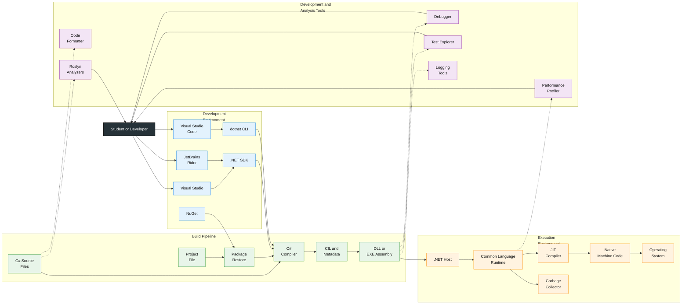

    

        
    

# **`Awesome`** C# Programming Resources 

 

    
    &nbsp;
    
    &nbsp;
    

```mermaid
flowchart LR
    SOURCE["C# Source Code<br/>.cs files"]
    PROJECT["Project Configuration<br/>.csproj"]
    PACKAGES["NuGet Packages"]

    SOURCE --> BUILD["dotnet build"]
    PROJECT --> BUILD
    PACKAGES --> RESTORE["Package Restore"]
    RESTORE --> BUILD

    BUILD --> ROSLYN["Roslyn C# Compiler"]

    ROSLYN --> CHECK{"Compilation<br/>successful?"}

    CHECK -->|"No"| ERRORS["Syntax,<br/>type or<br/>reference errors"]
    ERRORS --> SOURCE

    CHECK -->|"Yes"| ASSEMBLY["Managed<br/>Assembly<br/>EXE or DLL"]

    ASSEMBLY --> IL["Common<br/>Intermediate<br/>Language"]
    ASSEMBLY --> META["Type<br/>Metadata"]
    ASSEMBLY --> MANIFEST["Assembly<br/>Manifest"]

    IL --> HOST[".NET Host"]
    META --> CLR["Common<br/>Language<br/>Runtime"]
    MANIFEST --> CLR
    HOST --> CLR

    CLR --> LOAD["Assembly Loading"]
    LOAD --> VERIFY["Type and<br/>Safety Checks"]
    VERIFY --> JIT["JIT<br/>Compilation"]
    JIT --> MACHINE["Native<br/>Machine Code"]
    MACHINE --> CPU["CPU<br/>Execution"]

    CLR --> GC["Garbage<br/>Collection"]
    CLR --> EXCEPT["Exception<br/>Handling"]
    CLR --> THREAD["Thread and<br/>Task Management"]

    GC -.-> MACHINE
    EXCEPT -.-> MACHINE
    THREAD -.-> MACHINE

    classDef source fill:#e3f2fd,color:#111,stroke:#1e88e5
    classDef compiler fill:#e8f5e9,color:#111,stroke:#43a047
    classDef decision fill:#fff3e0,color:#111,stroke:#fb8c00,stroke-width:2px
    classDef assembly fill:#f3e5f5,color:#111,stroke:#8e24aa
    classDef runtime fill:#e0f7fa,color:#111,stroke:#00838f
    classDef error fill:#ffebee,color:#111,stroke:#e53935

    class SOURCE,PROJECT,PACKAGES,RESTORE source
    class BUILD,ROSLYN compiler
    class CHECK decision
    class ASSEMBLY,IL,META,MANIFEST assembly
    class HOST,CLR,LOAD,VERIFY,JIT,MACHINE,CPU,GC,EXCEPT,THREAD runtime
    class ERRORS error
```

## 📖 Contents
- [Books](#books)
- [Videos](#videos)
- [My Other Awesome Lists](#my-other-awesome-lists)
- [Contributing](#contributing)
- [Contributors](#contributors)

##

### Books

### Videos
- [Everything You Need to Know About the Latest in C#](https://youtu.be/jRJa83DeOd8?si=3rWZ-7x3rYqVePnU)
 
##

### My Other Awesome Lists
You can access the my other awesome lists [here](https://cyberthreatdefence.com/my_awesome_lists)

### Contributing
[Contributions of any kind welcome, just follow the guidelines](contributing.md)!

### Contributors
[Thanks goes to these contributors](https://github.com/cybersecurity-dev/awesome-csharp-programming-resources/graphs/contributors)!

### License

[🔼 Back to top](#awesome-c-programming-resources-)
